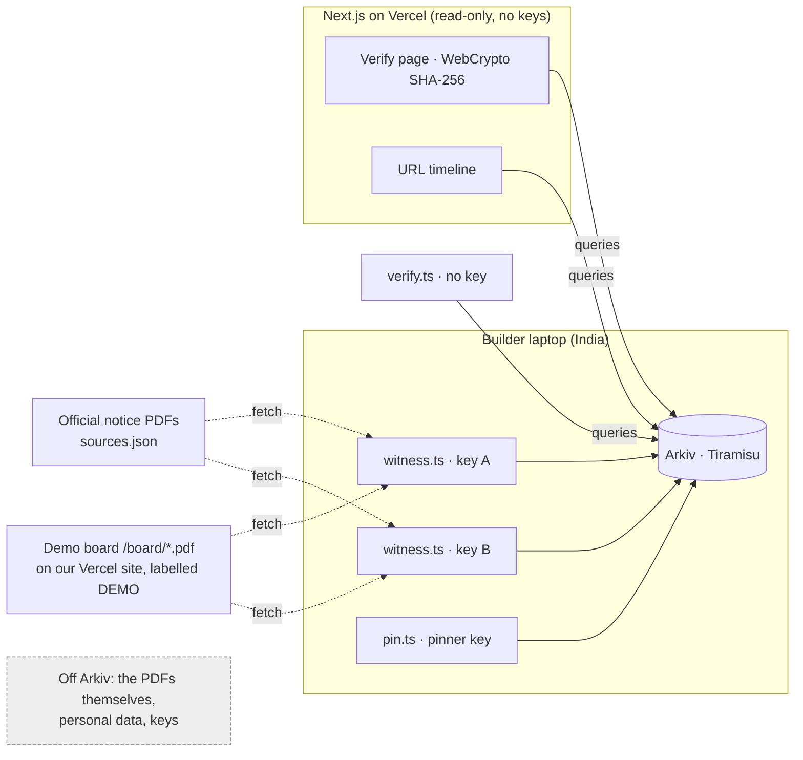

# CLAUDE.md — Sakshi (साक्षी): an independent witness record of what official notice pages actually served

Arkiv: Global Tour Stop (Devfolio). **Hard deadline: 18 Oct 2026 23:59 BST = 19 Oct 2026 04:29 IST.** Target: submitted by **03:50 IST**.
Canonical rules: https://github.com/Arkiv-Network/global-tour-stop-pre-devcon (RULES.md, docs/scoring-rubric.md, docs/submission-checklist.md, AGENTS.md). The repo wins over anything here.
Tracks: **Best Indian Use Case** (primary), **Censorship Resistance**, **Security**, **Open Source**.

---

## 0. Non-negotiable rules

1. `@arkiv-network/sdk@0.8.1` exactly (not 0.8.0) + `viem@^2`. Chain `tiramisu` from `@arkiv-network/sdk/chains` (id 7738577). `http`/`webSocket` transports come from `viem`.
2. **The web app holds no private keys and has no write routes.** All writes happen from the CLI on the builder's laptop. Keys live only in local `.env` (gitignored from commit #1). Never `NEXT_PUBLIC_` a key. Never log a key.
3. **No personal data in Arkiv**, plaintext or hashed. Witness only notice PDFs (recruitment/exam/scholarship announcements). **Never** witness result lists, merit lists, admit cards, or any page containing people's names.
4. Attribute names lowercase snake_case. String attribute values ≤ 128 bytes → URLs never go in attributes (use `url_key`, put the URL in the payload).
5. Filter only on attributes; numbers used in ranges are `u64`. No server-side ordering: sort on the client. Max 200 per page; use `cursor`.
6. Every entity must still exist on **23 Oct 2026** (judging): minimum lifetime `fromDays(30)`.
7. Public repo, MIT. Work is new (built 18 Oct). Pre-existing work: "None" (create-next-app + npm libraries).
8. Commit often. Never rewrite history after 04:29 IST.
9. Update `/arkiv/friction.md` **as things happen** with versions, expected vs actual, repro. Never invent friction.
10. Vocabulary: "Arkiv entities", "Entity Expiration", "Lifetime Extension", "the Web3 database". Never "TTL".
11. Be honest in UI copy: "Not seen" ≠ "fake". Demo-board sources are labelled **DEMO SOURCE** everywhere.

---

## 1. Product

Candidates get notice PDFs forwarded on WhatsApp/Telegram claiming to be from an official site. Official sites change, remove files, go down, or get blocked; India blocked the Internet Archive's Wayback Machine in Aug 2017. Sakshi is a set of **witnesses** (anyone can run one) that fetch notice PDFs from official URLs and record on Arkiv: *"at block time T, URL U served a file with SHA-256 H"*, plus when that file **changed** or the URL went **gone**.

Users can:
- **Verify a file.** Drop a PDF → hashed in the browser → "Served at <official URL>, first seen …, still served as of run …, by 2 witnesses" **or** "Was served until replaced on …" **or** "Not seen by any trusted witness (this does not mean it is fake; check the official site)".
- **See a URL's timeline**: seen → changed → gone, per witness.
- **Choose which witnesses to trust**. Results are filtered by on-chain `$creator`, never by a writable field.
- **Pin evidence**: any wallet can extend a record's lifetime (permissionless extension), e.g. before a dispute.
- **Verify without our website**: `npx tsx scripts/verify.ts file.pdf` reads the public RPC directly.

What it proves: witness W committed, no later than the block timestamp, that U returned bytes hashing to H.
What it does **not** prove: that W fetched honestly (no TLS proof; zkTLS/TLSNotary is roadmap), that the official site wasn't compromised, or anything about screenshots or recompressed images. In this demo **both witnesses are run by us**; say so.

---

## 2. Architecture



Reads from the browser go straight to the RPC. **If preflight test 4 fails** (WASM/CORS), move reads to `src/app/api/q/route.ts` (`export const runtime = "nodejs"`) and keep the CLI as the no-backend proof.

### Wallets (testnet, synthetic roles)
| Env var (local `.env` only) | Role |
|---|---|
| `WITNESS_A_PRIVATE_KEY` | Witness A ("Sakshi witness A, Ghaziabad") |
| `WITNESS_B_PRIVATE_KEY` | Witness B (same operator, run separately; disclose this) |
| `PINNER_PRIVATE_KEY` | A third party that pins records it does not own |

Public config (`src/lib/config.ts`, committed): `PROJECT="sakshi-v1"`, `WITNESSES=[{address,label}]`, `EXPLORER="https://tiramisu.explorer.arkiv.network"` (confirm the tx/address/entity URL patterns on the explorer during preflight).

---

## 3. Schema (mirror of /arkiv/schema.md)

All entities: `project="sakshi-v1"`, `entity_type`, `schema_version=i32(1)`, `contentType:"application/json"`, flags `{ readonly: true, permissionlessExtension: true }`.

### `observation`
| Attribute | Type | Notes |
|---|---|---|
| `kind` | str | `seen` (first sighting of this URL by this witness) · `changed` (URL now serves a different hash) · `gone` (URL now 404/410) |
| `url_key` | bytes32 | sha256(normalized URL). Normalize: lowercase scheme+host, drop `#fragment`, keep path+query exactly |
| `domain` | str | lowercase hostname |
| `doc_sha256` | bytes32 | hash of the bytes served (absent on `gone`) |
| `prev_sha256` | bytes32 | previous hash (on `changed`, `gone`) |
| `fetched_at` | u64 | unix seconds |
| `http_status` | i32 | |
| `source_tier` | str | `official` or `demo` |

Payload: `{ url, final_url, title, content_type, content_length, etag, last_modified, witness_label }`.
Entity Expiration: `fromDays(30)` at creation. **Lifetime Extension as a lease renewed by activity:** each run that finds the same hash again extends the current observation by `fromDays(30)` from now; a record that stops being re-confirmed fades out after 30 days unless someone pins it. `pin.ts` extends by `fromDays(180)`.

### `run`
| Attribute | Type |
|---|---|
| `run_at` | u64 |
| `sources_checked` | i32 |
| `changes` | i32 |

Payload: `{ witness_label, url_keys_checked: [...], sdk: "0.8.1" }`. Expiration `fromDays(30)`.
Purpose: "still served as of <run_at>" for URLs whose hash didn't change (the observation itself is readonly and isn't rewritten).

### One witness pass = one atomic batch
`executeBatch({ creates: [...newObservations, run], extensions: [...unchangedObservationKeys → fromDays(30)] })`.
If preflight test 2 shows batching creates and extensions together fails → sequential awaited writes, logged in friction.md.

### Queries
```ts
const P = eq("project","sakshi-v1"), OBS = eq("entity_type","observation");
// Q1 verify a file (then filter hits to trusted witnesses on the client by `creator`)
select({key:true,creator:true,createdAt:true,attributes:true,payload:true,expiresAt:true}).where(P, OBS, eq("doc_sha256", bytes32(h)))
// Q2 URL timeline for one trusted witness
select(...).where(P, OBS, eq("url_key", bytes32(k))).createdBy(W)         // sort by fetched_at on the client
// Q3 latest run of a witness
select(...).where(P, eq("entity_type","run")).createdBy(W)                // client: max run_at
// Q4 witness's own latest observation for a URL (used by witness.ts before writing) = Q2 with W = self
// Q5 (stretch) recent changes: where(P, OBS, or(eq("kind","changed"), eq("kind","gone")), gte("fetched_at", u64(now-7d)))
```
If `bytes32` equality fails in preflight → store hashes as lowercase `0x…` hex `str` (66 chars) everywhere and log it.

### Verdict logic (`src/lib/verdict.ts`, pure, unit-tested)
For hits from Q1 filtered to trusted witnesses, group by (`creator`, `url_key`); fetch Q2 for that pair; take the latest observation:
- latest.doc_sha256 == h → **SERVED** ("still served as of <latest run_at of that witness>")
- latest.kind == changed → **REPLACED** ("served from <hit.fetched_at> until replaced on <latest.fetched_at>")
- latest.kind == gone → **REMOVED** ("served from … until the URL disappeared on …")
- no hits → **NOT SEEN** (explicitly: not proof of forgery)
Show count of distinct witnesses; badge `DEMO SOURCE` when `source_tier=demo`.

---

## 4. Directory layout
```
sakshi/
├── CLAUDE.md · README.md · LICENSE (MIT) · .env.example (names only)
├── arkiv/schema.md · arkiv/friction.md        (required by the rules)
├── sources.json                                (official PDF URLs that passed preflight + demo board URLs)
├── public/board/index.html + notice-1.pdf … notice-3.pdf   (DEMO board, served by Vercel)
├── public/samples/                             (copies of every witnessed PDF version, incl. pre-change v1 files, for judges)
├── src/lib/config.ts · arkiv.ts (public client) · schema.ts (attr builders) · queries.ts · verdict.ts · hash.ts · url.ts
├── src/app/page.tsx         Verify dropzone + verdict + witness filter
├── src/app/url/page.tsx     URL timeline (?u=<url>)
├── src/app/how/page.tsx     What it proves / doesn't, trust model, witness list, CLI usage
├── scripts/preflight.ts     the 5 go/no-go tests
├── scripts/fund.ts          send GLM from A to B and pinner
├── scripts/make-board.ts    pdf-lib synthetic demo notices (fixed creation/mod dates)
├── scripts/witness.ts       one pass: fetch → hash → diff vs own latest → batch write
├── scripts/pin.ts           extend any observation from the pinner wallet
├── scripts/verify.ts        read-only CLI verdict, no key
└── tests/verdict.test.ts    vitest
```

---

## 5. Preflight (must run before building features; record every result in friction.md)

`scripts/preflight.ts`, one command, prints PASS/FAIL per test:
1. **Attributes & query**: create one `observation` with `bytes32` `url_key`/`doc_sha256`, `u64` `fetched_at`; query `eq(doc_sha256) + gte(fetched_at) + createdBy(A)` → expect exactly 1, `creator==A`, payload URL readable.
2. **Batch + extension + pin**: A creates X (`readonly`, `permissionlessExtension`, 30d) → A `executeBatch({creates:[Y], extensions:[{X, fromDays(60)}]})` → pinner `extendEntity({X, fromDays(120)})` → expect one tx for the batch and `expiresAt` increasing twice, owner/creator still A.
3. **Wallets & RPC**: balances of A/B/pinner > 0 after `fund.ts`; 20 sequential queries, no 4xx.
4. **Browser read on Vercel**: deployed `/preflight` client page renders `getEntityCount()` and one query result; no console errors.
5. **Sources**: fetch each candidate official PDF twice, 5 min apart → keep only `200` + `%PDF` + identical hash. Need ≥5 (≥3 acceptable).

Fallbacks: (1) hex `str` hashes · (2) sequential writes / drop pin · (3) per-address faucet, single key, serialized writes, Hub access key · (4) `/api/q` server reads · (5) fewer real sources; commit them to `public/samples/`.

---

## 6. Build order (IST) — stop adding scope when a checkpoint slips

| Time | Work |
|---|---|
| 21:30–22:00 | `create-next-app` (TS, Tailwind, App Router, src dir), `npm i @arkiv-network/sdk@0.8.1 viem pdf-lib`, `npm i -D tsx vitest dotenv`. MIT, `.gitignore` (`.env*`), public GitHub repo. 3 keys into `.env`. Faucet → A. `make-board.ts` → `public/board/`. **Deploy to Vercel now** (board needs a public URL) with `/preflight` page. |
| 22:00–22:30 | `fund.ts`, `preflight.ts` tests 1–5. Note the time of the first entity → form Q12. Lock fallbacks. |
| 22:30–23:45 | `witness.ts` (UA `SakshiWitness/0.1 (+repo)`, 20 s timeout, follow redirects, PDF-only, `404/410 → gone` only if a prior observation exists, other errors → skip + log, never `gone`). Run **pass 1 for A and B** over sources.json. Copy fetched PDFs to `public/samples/`. |
| 23:45–01:00 | Web (mobile-first; verdict labels in Hindi + English, e.g. "सर्व किया गया · SERVED"): Verify page + verdict + witness toggles; "Try it" box linking `public/samples/`; URL timeline; How page. `verdict.test.ts`. Commit + deploy. |
| 01:00–01:30 | Demo change: replace `board/notice-2.pdf` with a version whose deadline differs; delete `board/notice-3.pdf`; push (Vercel redeploys). Keep v1 copies in `public/samples/`. Run **pass 2 for A and B** → expect `changed` + `gone` + extensions + `run`. `pin.ts` one observation. `verify.ts` CLI. |
| 01:30–02:00 | Final deploy. Test in incognito on phone + desktop: real PDF → SERVED; `samples/notice-2-v1.pdf` → REPLACED; `samples/notice-3.pdf` → REMOVED; edited PDF → NOT SEEN; witness toggle changes results; CLI matches web. |
| 02:00–02:40 | README, schema.md (real addresses, entity keys, tx links), friction.md. |
| 02:40–03:20 | Video ≤ 3:00 (script in SUBMISSION.md). |
| 03:20–03:50 | Devfolio form, tracks, final commit. **03:50–04:29 buffer, no pushes after 04:29.** |

Checkpoints: **22:30** if preflight 1 or 3 fails and the fallback also fails → run on the demo board only and say so. **00:45** if the Verify page isn't deployed and working → freeze features; go straight to pass 2, docs, video.

Stretch only after 01:30 and only if green: live feed via `watchEntityEvents` on `webSocket()` with no `fromBlock` (filter `project` client-side); Q5 recent-changes page.

## 7. Do not build
Write routes in the web app · issuer accreditation · HTML-page witnessing · OCR or image matching · AI features · storing PDFs on Arkiv · witnessing any page with people's names · wallet connect.
