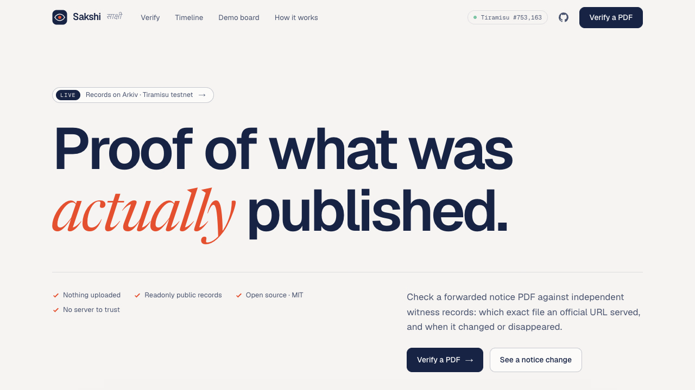
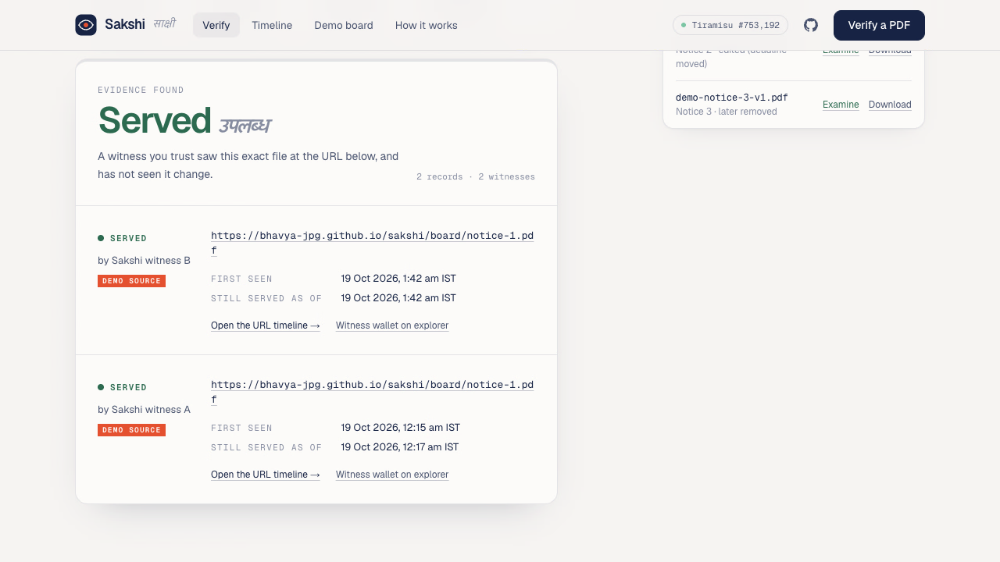
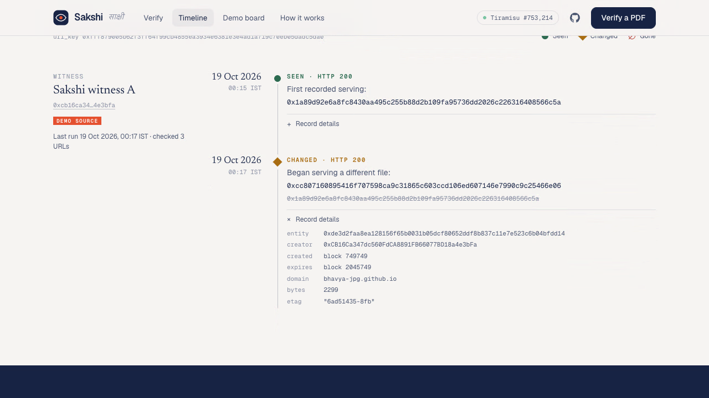
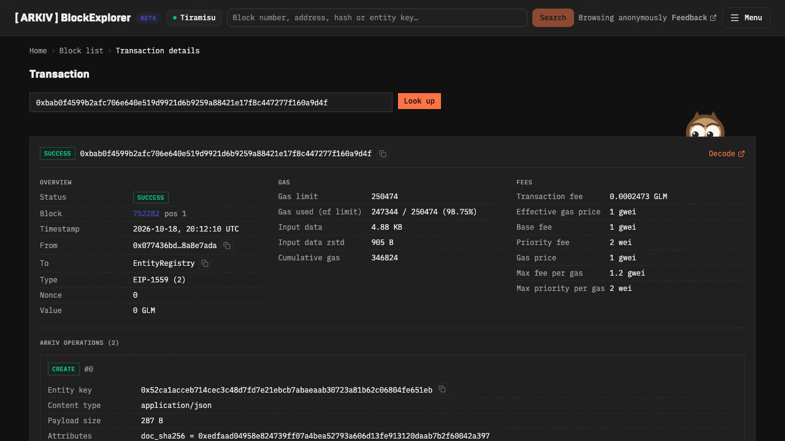
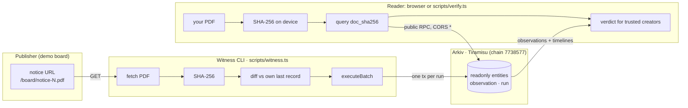
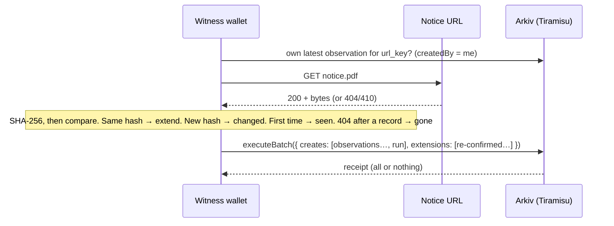
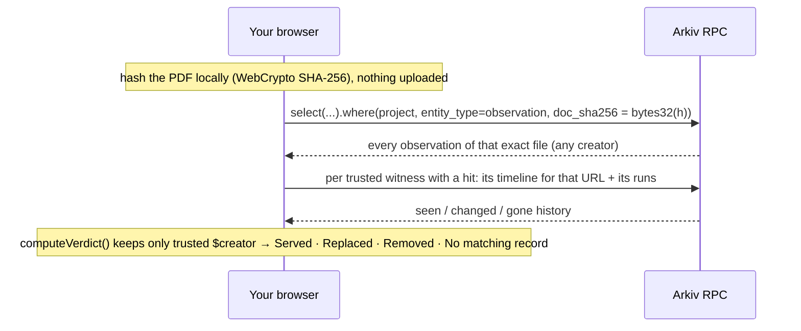

<div align="center">

# Sakshi · साक्षी

### Proof of what a notice page *actually* published.

An independent witness archive for public recruitment and examination notices, built on **[Arkiv](https://arkiv.network)**, the Web3 database.

**[Live app](https://bhavya-jpg.github.io/sakshi/)** · **[Verify a PDF](https://bhavya-jpg.github.io/sakshi/verify/)** · **[Demo video](submission/video2/sakshi_explainer.mp4)** · **[Schema](arkiv/schema.md)** · **[Friction report](arkiv/friction.md)**


</div>

---

## Contents
1. [The problem](#the-problem)
2. [What Sakshi does](#what-sakshi-does)
3. [Try it in two minutes](#try-it-in-two-minutes)
4. [Screenshots and demo video](#screenshots-and-demo-video)
5. [How it works](#how-it-works)
6. [The data on Arkiv](#the-data-on-arkiv)
7. [Verdicts and the trust model](#verdicts-and-the-trust-model)
8. [On-chain evidence](#on-chain-evidence)
9. [Quick start (local)](#quick-start-local)
10. [Command-line tools](#command-line-tools)
11. [Run your own witness](#run-your-own-witness)
12. [Reproduce the demo end to end](#reproduce-the-demo-end-to-end)
13. [Project structure](#project-structure)
14. [Testing](#testing)
15. [Deployment](#deployment)
16. [Security and privacy](#security-and-privacy)
17. [Limitations: what Sakshi does not prove](#limitations-what-sakshi-does-not-prove)
18. [Building on Arkiv: what we learned](#building-on-arkiv-what-we-learned)
19. [Hackathon submission](#hackathon-submission)
20. [Credits and licence](#credits-and-licence)

---

## The problem

Recruitment, examination and scholarship candidates in India act on notice PDFs forwarded through WhatsApp groups, Telegram channels and coaching networks. The usual advice is "check the official site". That advice fails when:

- **a page changes quietly.** A deadline moves or a fee changes, and the old file is replaced at the same URL.
- **a file disappears.** Notices are withdrawn or sites go down, just when someone needs to prove what was said.
- **the archive itself can be blocked.** India blocked the Internet Archive's Wayback Machine in August 2017 ([The Wire](https://thewire.in/tech/access-internet-archives-wayback-machine-blocked)). A single archive operator is a single point of failure.

So the real question isn't "is this PDF fake?", which no hash can answer. It is: **did a witness I trust see this exact file served at that URL, and when, and did it later change or vanish?**

## What Sakshi does

| | |
|---|---|
| **Witnesses record** | A small open-source CLI fetches notice PDFs from their URLs, computes each file's SHA-256, compares it with its own last record, and writes **readonly observations** to Arkiv: `seen`, `changed` or `gone`. |
| **Anyone verifies** | Drop a PDF into the web app (or use the CLI). Your device computes its fingerprint; Sakshi asks Arkiv which witnesses recorded that exact file, at which URL, and when. **Nothing is uploaded.** |
| **You choose whom to trust** | Results count only the witness wallets you tick. Trust comes from the record's immutable on-chain creator, never from a self-declared label. |
| **No server to take down** | The website is static files on GitHub Pages; your browser talks to the public Tiramisu RPC directly. The CLI does the same without the website. |
| **Honest answers** | *Served*, *Replaced*, *Removed* or *No matching record*. The last one is explicitly **not** evidence that a document is fake. Verdicts are shown in English and Hindi. |

## Try it in two minutes

1. Open **https://bhavya-jpg.github.io/sakshi/verify/**
2. In the **Specimens** panel, click **Examine** next to each file (synthetic notices from our labelled demo board):

   | Specimen | What happened on the demo board | Verdict you should see |
   |---|---|---|
   | `demo-notice-1-v1.pdf` | still published | **Served**, 2 witnesses (A and B) |
   | `demo-notice-2-v1.pdf` | original; later its deadline moved from 30 Nov to 05 Nov | **Replaced** |
   | `demo-notice-2-v2.pdf` | the edited version | **Served** |
   | `demo-notice-3-v1.pdf` | later withdrawn (the URL now returns 404) | **Removed** |

3. With notice 1 examined, **untick Witness B**: the count drops to 1 witness and B's record is listed as *ignored*. Untick both: **No matching record**. No new network requests are made for the toggles.
4. Edit any byte of a PDF and drop it in: **No matching record**, with an explanation of why that is not proof of forgery.
5. Open the **[timeline for notice 2](https://bhavya-jpg.github.io/sakshi/timeline/?u=https%3A%2F%2Fbhavya-jpg.github.io%2Fsakshi%2Fboard%2Fnotice-2.pdf)**: `seen` → `changed`, with entity keys, blocks and expiry.

## Screenshots and demo video

**Demo video (2:02, motion-graphics explainer with narration):** [`submission/video2/sakshi_explainer.mp4`](submission/video2/sakshi_explainer.mp4). A 2:45 live-app walkthrough is also available: [`submission/video/sakshi_demo.mp4`](submission/video/sakshi_demo.mp4).

| Live landing page | A verification (real result) |
|---|---|
|  |  |
| **URL timeline for notice 2** | **Witness B's transaction on the Arkiv explorer** |
|  |  |

## How it works

### Architecture



### A witness run (one atomic transaction)



### A verification



## The data on Arkiv

Full contract: **[`arkiv/schema.md`](arkiv/schema.md)**. All entities use `project = "sakshi-v1"`, `schema_version = 1`, `contentType: application/json`, creation flags **`readonly`** and **`permissionlessExtension`**, and an **Entity Expiration** of `ExpirationTime.fromDays(30)`.

### `observation`: what one URL served at one moment
| Attribute | Type | Meaning |
|---|---|---|
| `kind` | `str` | `seen` · `changed` · `gone` |
| `url_key` | `bytes32` | SHA-256 of the normalised URL (lowercase scheme and host, no fragment) |
| `domain` | `str` | hostname |
| `doc_sha256` | `bytes32` | SHA-256 of the served bytes (absent when `gone`) |
| `prev_sha256` | `bytes32` | the witness's previous hash for this URL |
| `fetched_at` | `u64` | unix seconds |
| `http_status` | `i32` | HTTP status |
| `source_tier` | `str` | `official` or `demo` |

Payload (JSON): `url`, `final_url`, `title`, `content_type`, `content_length`, `etag`, `last_modified`, `witness_label`. The URL lives in the payload because `str` attributes are limited to 128 bytes; queries go through `url_key`.

### `run`: one witness pass
`run_at` (`u64`), `sources_checked` (`i32`), `changes` (`i32`); payload `{ witness_label, url_keys_checked, sdk }`.

### Lifetime Extension
When a witness sees the same file again, its run extends that observation by `fromDays(30)` from now, in the same batch, but only if that is later than the current expiry (an extension that isn't later reverts, and would fail the whole batch). Records that stop being re-confirmed expire on their own; because of `permissionlessExtension`, anyone can extend a record they want to keep as evidence.

### Queries the app runs ([`src/lib/arkiv.ts`](src/lib/arkiv.ts))
```ts
const P = eq("project", str("sakshi-v1")), OBS = eq("entity_type", str("observation"))
// Q1 verify a file
client.select(OBS_FIELDS).where(P, OBS, eq("doc_sha256", bytes32(h))).limit(200).fetch()
// Q2 a URL's timeline (optionally one witness)
client.select(OBS_FIELDS).where(P, OBS, eq("url_key", bytes32(k))).createdBy(W).limit(200).fetch()
// Q3 runs (one query for all configured witnesses, filtered locally)
client.select(RUN_FIELDS).where(P, eq("entity_type", str("run"))).limit(200).fetch()
```
Only the fields the app reads are selected; results are paged with `cursor` and sorted on the client (Arkiv has no server-side ordering).

### What is deliberately **not** on Arkiv
The PDFs themselves, any personal data (we never witness result lists, merit lists or admit cards), and all private keys.

## Verdicts and the trust model

Logic: [`src/lib/verdict.ts`](src/lib/verdict.ts) (pure, unit-tested). For each *(trusted creator, URL)* that has observed hash **H**:

| Verdict | Condition | Shown as |
|---|---|---|
| **Served** | no later record by that witness shows a different hash or `gone`; "still served as of" its latest run | उपलब्ध |
| **Replaced** | a later `changed` record shows a different hash | बदला गया |
| **Removed** | a later `gone` record exists | हटाया गया |
| **No matching record** | no trusted witness has H. **Not evidence of a fake.** | कोई रिकॉर्ड नहीं |

**Trust is per wallet.** The reader picks witness addresses; only records whose immutable `$creator` is one of them count. A record that merely *claims* an official `domain` from an unknown wallet is ignored and shown as ignored. Distinct witnesses are counted by distinct lowercased creator address, not by number of records. Records are readonly, so a compromised witness can add new claims but cannot rewrite what it already said, and readers can untick it.

**Witness identities in this build** (configured in [`src/lib/config.ts`](src/lib/config.ts)):

| Witness | Address | Role |
|---|---|---|
| A | [`0xCB16Ca347dc560FdCA8891FB66077BD18a4e3bFa`](https://tiramisu.explorer.arkiv.network/address/0xCB16Ca347dc560FdCA8891FB66077BD18a4e3bFa) | two runs over the demo board; ran the preflight test; funded B |
| B | [`0x077436BD0DF0A9050e8f6be74ee9dEF58A8E7AdA`](https://tiramisu.explorer.arkiv.network/address/0x077436BD0DF0A9050e8f6be74ee9dEF58A8E7AdA) | one run (notice 1) |

> A and B are **distinct witness identities** (separate keys and wallets) operated by the same team. They are **not** independent organisations. Anyone can add a genuinely independent witness by running `scripts/witness.ts` with their own key.

## On-chain evidence

All on Tiramisu (chain `7738577`). Explorer: `https://tiramisu.explorer.arkiv.network/tx/<hash>`.

| What | Transaction |
|---|---|
| Preflight: first entity (19 Oct 00:15 IST) | [`0xb3aaa9a9aa20b04b1617e1337e244899060a9f6f16c6861c481e5e757efb4f04`](https://tiramisu.explorer.arkiv.network/tx/0xb3aaa9a9aa20b04b1617e1337e244899060a9f6f16c6861c481e5e757efb4f04) |
| Preflight: batch create + Lifetime Extension | [`0x20db0619dbac00452b4e795bc6bb9efad11d9f9ee6e4b920b95b6a96639d4d5b`](https://tiramisu.explorer.arkiv.network/tx/0x20db0619dbac00452b4e795bc6bb9efad11d9f9ee6e4b920b95b6a96639d4d5b) |
| Witness A run 1: 3 × `seen` + `run` (board phase 1) | [`0x7707c7e1c68b65127c5d46b2225be787a19a7faef5af88c1b12fc2f2eec51745`](https://tiramisu.explorer.arkiv.network/tx/0x7707c7e1c68b65127c5d46b2225be787a19a7faef5af88c1b12fc2f2eec51745) |
| Witness A run 2: `changed` + `gone` + `run` + extension (phase 2) | [`0x6969dab4b65b72853304c36fe7679007cd5f2c4aa5bdc06ff9e24342232fc519`](https://tiramisu.explorer.arkiv.network/tx/0x6969dab4b65b72853304c36fe7679007cd5f2c4aa5bdc06ff9e24342232fc519) |
| Fund Witness B: 0.01 GLM from A | [`0x8ef2278c768cfdaf7ab20a9394f36fb66cda66115af2be88ad3cc1d4bc9fbe85`](https://tiramisu.explorer.arkiv.network/tx/0x8ef2278c768cfdaf7ab20a9394f36fb66cda66115af2be88ad3cc1d4bc9fbe85) |
| Witness B run 1: `seen` (notice 1) + `run` | [`0xbab0f4599b2afc706e640e519d9921d6b9259a88421e17f8c447277f160a9d4f`](https://tiramisu.explorer.arkiv.network/tx/0xbab0f4599b2afc706e640e519d9921d6b9259a88421e17f8c447277f160a9d4f) |

Example entity keys are listed in [`arkiv/schema.md`](arkiv/schema.md#on-chain-evidence-tiramisu).

## Quick start (local)

Requires **Node 22+** and npm.

```bash
git clone https://github.com/bhavya-jpg/sakshi && cd sakshi
npm install
npm test          # 33 unit tests (pure, no network)
npm run dev       # http://localhost:3000, read-only, reads Tiramisu directly
npm run build     # static export to out/
```

No configuration is needed to read: the app and the CLI use the public Tiramisu RPC `https://rpc.tiramisu.db-chain.testnet.arkiv.network`.

| Stack | Version |
|---|---|
| `@arkiv-network/sdk` | 0.8.1 (pinned) |
| `viem` | 2.x |
| Next.js (App Router, static export) | 15.5 |
| React | 19 |
| Tailwind CSS | 4 |
| Tests | Vitest |
| Demo PDFs | pdf-lib (deterministic bytes) |

## Command-line tools

| Command | What it does | Needs a key? |
|---|---|---|
| `npx tsx scripts/verify.ts <file.pdf> [--trust 0xA,0xB]` | Hash a file and print the verdict and full evidence, straight from the public RPC | no |
| `npx tsx scripts/witness.ts [--dry-run] [--sources f.json] [--key-env VAR] [--label "..."]` | One witness pass: fetch, hash, diff, and write one `executeBatch` | yes |
| `npx tsx scripts/preflight.ts` | Integration test on Tiramisu: create, confirm, read back, query, check creator and payload, batch + extension (17 checks) | yes |
| `npx tsx scripts/fund.ts --to 0x… [--amount 0.01] [--send]` | Send test GLM from Witness A to another witness; **dry run by default**; refuses wrong chain or amounts over 0.1 GLM | yes |
| `npx tsx scripts/make-board.ts` | Regenerate the synthetic demo-board PDFs (byte-identical every time) | no |
| `npx tsx scripts/balance.ts <address>` | Chain id, block, entity count and a balance | no |

Real `verify.ts` output (run 19 Oct 2026, 01:59 IST):
```
verdict   REPLACED  (Replaced · बदला गया)
  REPLACED  [DEMO SOURCE]
  url             https://bhavya-jpg.github.io/sakshi/board/notice-2.pdf
  first seen      2026-10-18T18:45:51Z
  replaced        2026-10-18T18:47:38Z  by 0xcc807160895416f707598ca9c31865c603ccd106ed607146e7990c9c25466e06
    2026-10-18T18:45:51Z  seen    0x1a89d92e…  entity 0x09ab88cd3eb609ee9c9d6758ea6266856277cbe36e4b9ff1107b540d6438745c
    2026-10-18T18:47:38Z  changed 0xcc807160…  entity 0xde3d2faa8ea128156f65b0031b05dcf80652ddf8b837c11e7e523c6b04bfdd14
```

## Run your own witness

1. Create a key and fund it with Tiramisu test GLM (the [Hub faucet](https://hub.arkiv.network/faucet), or a transfer from a funded wallet). Never commit keys:
   ```bash
   cp .env.example .env      # WITNESS_A_PRIVATE_KEY=0x…   (.env* is gitignored)
   ```
2. List the URLs to watch in `sources.json` (`{ "url", "title", "tier": "official" | "demo" }`).
3. Dry run, then write:
   ```bash
   npx tsx scripts/witness.ts --dry-run
   npx tsx scripts/witness.ts --label "My witness"
   ```
4. A second identity keeps its key in its own gitignored file and is selected with `--key-env`:
   ```bash
   (set -a; . ./.env.witness-b; set +a; npx tsx scripts/witness.ts --key-env WITNESS_B_PRIVATE_KEY --label "Sakshi witness B")
   ```
5. To have the app trust your witness by default, add its **public** address to `WITNESSES` in `src/lib/config.ts`. Readers can always choose for themselves.

Each run writes exactly one transaction. A run's findings and its summary land together or not at all.

## Reproduce the demo end to end

The demo board at **[/board/](https://bhavya-jpg.github.io/sakshi/board/)** is a clearly labelled mock publisher ("Demonstration environment · Synthetic notices") serving stable URLs `/board/notice-1.pdf` … `notice-3.pdf`. The repository variable `BOARD_PHASE` selects what those URLs serve at build time:

| Phase | notice-1 | notice-2 | notice-3 |
|---|---|---|---|
| 1 | v1 | v1 (last date 30 Nov) | v1 |
| 2 (live now) | v1 | **v2 (last date 05 Nov)** | **404** |

Pinned SHA-256 of the specimens (checked by `tests/samples.test.ts`):

| File | SHA-256 |
|---|---|
| `demo-notice-1-v1.pdf` | `0xedfaad04958e824739ff07a4bea52793a606d13fe913120daab7b2f60042a397` |
| `demo-notice-2-v1.pdf` | `0x1a89d92e6a8fc8430aa495c255b88d2b109fa95736dd2026c226316408566c5a` |
| `demo-notice-2-v2.pdf` | `0xcc807160895416f707598ca9c31865c603ccd106ed607146e7990c9c25466e06` |
| `demo-notice-3-v1.pdf` | `0x7d4de10e0ae53d4403776b6d29e0d98e2f793991654f42050a0680ce6f5f6e61` |

To reproduce from scratch on your own fork:
1. Deploy with phase 1 (`gh variable set BOARD_PHASE --body 1`, push) and run a witness: three `seen` observations and one `run`.
2. Set `BOARD_PHASE=2`, redeploy, and run the witness again: `changed` for notice 2, `gone` for notice 3, an extension for notice 1, and one `run`.
3. Verify the four specimens: Served, Replaced, Served, Removed.

## Project structure

```
├── arkiv/
│   ├── schema.md            # data contract: entities, attributes, expiration, queries, wallets, txs
│   └── friction.md          # what we hit building on Arkiv (versions, expected vs actual, repro)
├── scripts/
│   ├── witness.ts           # witness CLI: fetch → hash → diff → one executeBatch
│   ├── verify.ts            # read-only verifier (no key, no website)
│   ├── preflight.ts         # 17-check integration test on Tiramisu
│   ├── fund.ts              # dry-run-first GLM transfer to a new witness
│   ├── make-board.ts        # deterministic synthetic demo PDFs
│   ├── prepare-board.mjs    # copies the board phase into public/board/ before a build
│   └── balance.ts           # chain/entity/balance check
├── src/
│   ├── lib/
│   │   ├── schema.ts        # attribute builders + decoders (the contract in code)
│   │   ├── arkiv.ts         # public client, queries Q1–Q3, field projection, retry
│   │   ├── service.ts       # fetchEvidence (queries) + verdictFromEvidence (pure)
│   │   ├── verdict.ts       # computeVerdict: Served / Replaced / Removed / No match
│   │   ├── snapshot.ts      # landing-page read (2 queries), session cache, shared block poller
│   │   ├── hash.ts          # WebCrypto SHA-256, URL normalisation, url_key
│   │   ├── config.ts        # project id, explorer, configured witnesses
│   │   └── samples.ts       # pinned specimen hashes
│   ├── app/                 # routes: / · /verify · /timeline · /board · /how
│   └── components/          # Verify, VerdictView, Timeline, Board, landing/*, site/*
├── tests/                   # verdict, witnesses (trust model), samples (pinned hashes)
├── public/board-files/      # v1/ and v2/ demo PDFs   ·   public/samples/ downloadable specimens
├── sources.json             # URLs the witness watches
├── .github/workflows/pages.yml   # test → static build → GitHub Pages
├── docs/SUBMISSION.md       # submission pack (verified facts)
└── submission/              # Devfolio answers, audit, checklist, videos and their sources
```

## Testing

```bash
npm test          # 33 tests, ~0.3 s, no network (fetch is disabled inside the witness suite)
npx tsc --noEmit  # type check
npm run build     # static export
```

| Suite | Covers |
|---|---|
| `tests/verdict.test.ts` | Served, Replaced, Removed, No match; untrusted creators ignored |
| `tests/witnesses.test.ts` | distinct-witness counting (repeat records, multiple URLs, address case), trust toggles recomputed from fetched evidence, refusing unfetched witnesses, verdict consistency across the verify, landing and core paths, single-witness compatibility, the real A + B shape |
| `tests/samples.test.ts` | demo PDFs are byte-identical to their pinned SHA-256 |

Live integration: `scripts/preflight.ts` passed **17/17** checks on Tiramisu (19 Oct 2026, 00:15 IST): create, receipt, read-back, creator, payload, typed attributes, flags, `bytes32` equality, `u64` range + `createdBy`, negative `createdBy`, and batch create + extension with `expiresAt` increasing.

## Deployment

- **Hosting:** GitHub Pages, built by [`.github/workflows/pages.yml`](.github/workflows/pages.yml) on every push to `main`: `npm ci` → `npm test` → `next build` (static export, `basePath=/sakshi`) → deploy.
- **No backend.** The SDK's read path has no WASM, and the RPC answers CORS with `*`, so the browser queries Arkiv directly.
- **RPC budget.** The public RPC meters `arkiv_query` per IP (we observed `Arkiv-Cost: 100` per query and a `limit=10000` budget). The landing page makes **2 queries** however many witnesses are configured, selects only the fields it reads, caches for 2 minutes in `sessionStorage`, and pauses its block poller in hidden tabs; trust toggles on `/verify` reuse fetched evidence instead of re-querying.

## Security and privacy

- **No keys in the site.** The web app is read-only and holds no secrets; keys live only in local, gitignored `.env*` files used by the CLIs.
- **Nothing uploaded.** Files are hashed on the reader's device; only the fingerprint is sent in a public query.
- **No personal data on Arkiv,** plaintext or hashed. Only hashes of public notice PDFs, their URLs and HTTP metadata.
- **Trust from `$creator`,** never from attributes or labels. **Readonly** records: history can't be rewritten.
- **Transfers are guarded:** `fund.ts` is dry-run by default, checks the chain id, recipient and an amount cap.

## Limitations: what Sakshi does not prove

- A record shows what a **witness committed to**, not that it fetched honestly. There is no TLS proof yet (zkTLS / TLSNotary would be the next step).
- It says nothing about whether the **source website itself** was compromised.
- A **changed hash** proves two files differ, not tampering, intent, or which version is authentic.
- **No matching record** is never evidence of a fake: the file may never have been witnessed, or it may have been re-saved or compressed.
- In this build **both witness identities are run by the Sakshi team**; Witness B has recorded notice 1 only.
- Only the **synthetic, labelled demo board** is witnessed; no real government PDF is in the record.
- The landing page reads all `run` entities in the project and filters locally; a flood of more than 2,000 fake runs could hide real ones from that page (verdicts on `/verify` are unaffected).

## Building on Arkiv: what we learned

Full report with versions and repro steps: **[`arkiv/friction.md`](arkiv/friction.md)**. Highlights:
- **The Hub faucet crashed on load** (`invalid border=0` from a QR component) while the status page showed 100% uptime, so we waited almost three hours for test GLM.
- **The per-IP query quota is easy to exhaust** and isn't documented; the SDK retries into a long reset.
- **What worked well:** typed attributes with clear validation errors, `bytes32` equality and `u64` ranges, `createdBy`, readonly + permissionless-extension flags, and `executeBatch` mixing creates and extensions in one transaction.
- **Pitfall:** Lifetime Extension reverts if the new expiry isn't later, which fails the whole batch; the witness guards against it.

## Hackathon submission

Built for **[Arkiv: Global Tour Stop](https://arkiv.devfolio.co/overview)** ([rules](https://github.com/Arkiv-Network/global-tour-stop-pre-devcon)). Tracks: **Best Indian Use Case**, **Censorship Resistance**, **Security**, **Open Source**.

| Requirement | Where |
|---|---|
| Working app on Tiramisu | https://bhavya-jpg.github.io/sakshi/ |
| Public repo, MIT | this repository, [`LICENSE`](LICENSE) |
| `/arkiv/schema.md` | [arkiv/schema.md](arkiv/schema.md) |
| `/arkiv/friction.md` | [arkiv/friction.md](arkiv/friction.md) |
| Wallets that create entities | [Witness identities](#verdicts-and-the-trust-model) |
| Reproduction steps + exact queries | [Try it](#try-it-in-two-minutes), [queries](#queries-the-app-runs-srclibarkivts) |
| Demo video ≤ 3 min | [`submission/video2/sakshi_explainer.mp4`](submission/video2/sakshi_explainer.mp4) (2:02) |
| Devfolio answers, audit, checklist | [`submission/`](submission/) |

**Pre-existing work:** none. Built 18–19 Oct 2026 (UTC 18 Oct) from `create-next-app` boilerplate and npm libraries. `CLAUDE.md` is the original build plan, kept for transparency; some planned items (a pinner wallet, a WebSocket live feed, witnessing real government PDFs) were not built.

## Credits and licence

- Built with [Arkiv](https://arkiv.network) (`@arkiv-network/sdk`), [viem](https://viem.sh), [Next.js](https://nextjs.org), [Tailwind CSS](https://tailwindcss.com), [pdf-lib](https://pdf-lib.js.org) and [Vitest](https://vitest.dev).
- Fonts: Geist, Geist Mono and Newsreader (SIL Open Font License).
- Demo video: motion graphics made with the method from [charlie947/motion-graphics-skills](https://github.com/charlie947/motion-graphics-skills); narration by [Chatterbox](https://github.com/resemble-ai/chatterbox) (Resemble AI, MIT); music synthesised with ffmpeg. Provenance in [`submission/video2/ASSETS.md`](submission/video2/ASSETS.md).
- Developed with Claude (Claude Code).

Released under the **[MIT licence](LICENSE)**.
